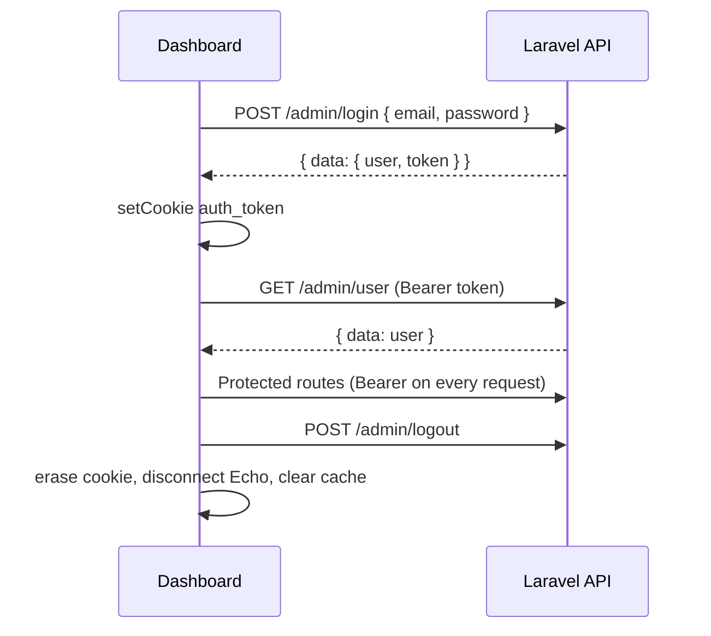

# Authentication

Sanctum **Bearer token** flow (not SPA cookie/CSRF mode).

## Sequence

(`VITE_API_URL` = `.../admin`, so hooks call `/login`, `/user`, `/logout`.)

## Frontend files

- `src/features/auth/api/useAuth.ts` — login, profile, logout hooks
- `src/shared/components/RouteGuards.tsx` — token check
- `src/shared/services/axios.ts` — attaches Bearer header
- Cookie key: `auth_token` (see `AUTH_TOKEN_KEY` in `cookies.ts`)

## Protected routes

All routes under `<ProtectedRoute />` require a token. Frontend `/login` page is public via `<PublicRoute />`.

## Profile in UI

Sidebar and Header read `useProfile()` for the current user's name and email.
